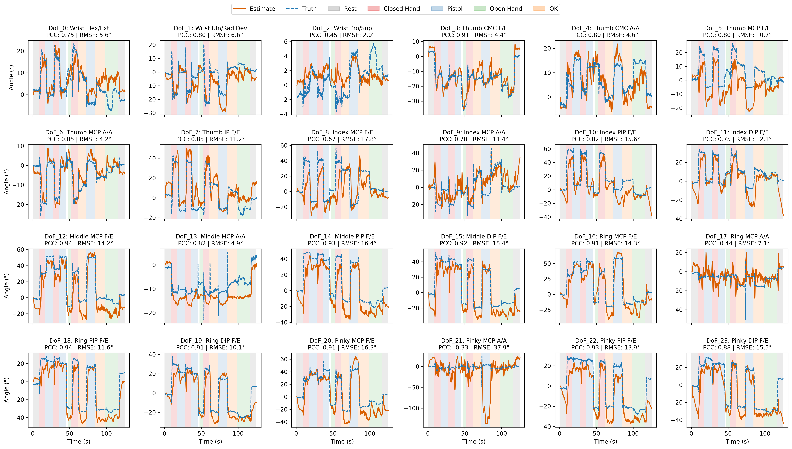
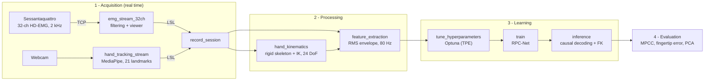
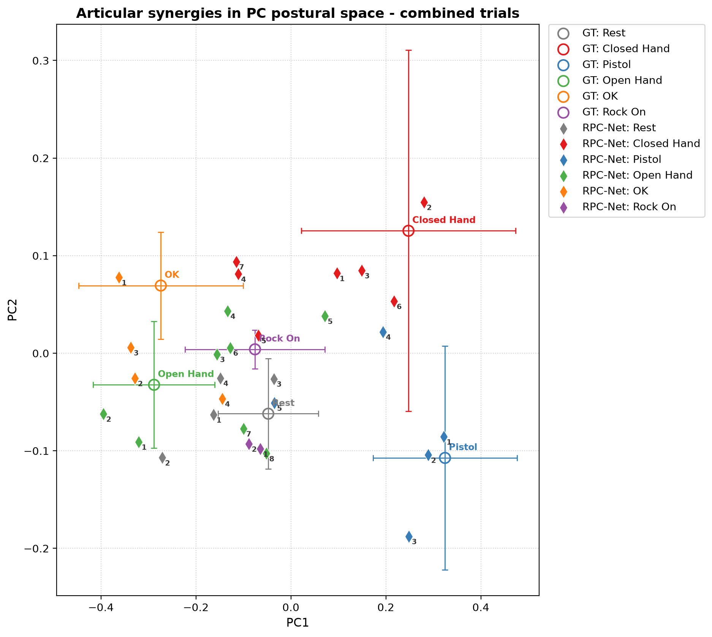

# EMG-to-Hand: Continuous Hand Pose Decoding from HD-EMG

**Decoding 24 degrees of freedom of the human hand from forearm muscle activity, using a webcam as the only source of ground truth.**


This is an end-to-end research pipeline for **myoelectric control of hand prostheses**. It records 32-channel
high-density surface EMG together with markerless 3D hand tracking, converts the noisy video landmarks into
biomechanically valid joint angles, and trains a neural network (**RPC-Net**) that predicts the full hand pose
continuously and proportionally from muscle activity alone.

Developed for the *Neural Prostheses* project at **Scuola Superiore Sant'Anna** and the **University of Pisa** (2026).

<p align="center">
  
  <br><em>RPC-Net estimate (orange) vs ground truth (blue, dashed) for all 24 DoF on an unseen test trial.
  Background colours mark the performed gestures.</em>
</p>

---

## Highlights

- **Full-stack pipeline**: hardware driver → real-time DSP → synchronized recording → biomechanical modelling → deep learning → evaluation.
- **Custom driver** for the OT Bioelettronica *Sessantaquattro* amplifier (TCP binary protocol, 32 ch @ 2 kHz), with a multi-threaded PyQt5 real-time viewer.
- **Synchronization** of 2 kHz EMG and ~30 Hz video on a shared Lab Streaming Layer (LSL) clock. Video frames are stamped when they are captured, not when inference finishes.
- **Low-cost ground truth**: a webcam and MediaPipe replace a motion-capture lab.
- **Biomechanical hand model**: subject calibration, forward kinematics and Jacobian (damped least-squares) inverse kinematics enforce a rigid skeleton and anatomical range of motion. This cuts the reconstruction error from **6.2 mm to 1.3 mm**.
- **RPC-Net** re-implemented from the literature: 24 parallel sub-networks fed by EMG history and their own past predictions (autoregressive), tuned with **Bayesian optimization (Optuna)**.
- **Realistic evaluation**: causal, sample-by-sample decoding on unseen trials, with per-trial EMG normalization to compensate for electrode-skin impedance drift.

---

## Pipeline



| Stage | What happens |
|---|---|
| **EMG acquisition** | The PC acts as a TCP server for the amplifier: 32 monopolar channels, 16-bit, 2 kHz, hardware high-pass. Samples are converted to µV and optionally filtered in real time with a stateful IIR bank (band-pass 10–450 Hz + 50 Hz notch harmonics). |
| **Hand tracking** | MediaPipe Hand Landmarker extracts 21 metric 3D landmarks per frame, published on LSL with the capture timestamp. |
| **Recording** | Both LSL streams are drained continuously and saved as time-aligned CSV pairs (`trial_N_EMG.csv`, `trial_N_Kinematics.csv`). |
| **Kinematic modelling** | Savitzky–Golay smoothing → projection on a calibrated rigid skeleton with 1-DoF hinge constraints and soft range-of-motion limits (Stillfried et al.) → damped-least-squares inverse kinematics → 24 joint angles. |
| **Features** | Zero-phase band-pass + notch filtering, rectification, RMS envelope (100 ms window, 12.5 ms step, ~80 Hz). Angles are rest-pose referenced and normalized to [0, 1]. |
| **Model** | From a 0.8 s history: 16 × 32 EMG features (512) + 8 × 24 past angles (192) → 24 sub-networks → 24 joint angles. |
| **Inference** | Autoregressive loop with causal low-pass smoothing; angles are mapped back to 3D landmarks with forward kinematics. |

---

## Results

Evaluated on **three trials never seen during training**. Signals are time-aligned and the first 0.8 s (network warm-up) is excluded.

| Test trial | MPCC (24 DoF) ↑ | Fingertip error, thumb/index/middle ↓ |
|:---:|:---:|:---:|
| Trial 6 | **76.5 %** | **23.1 mm** |
| Trial 9 | 43.1 % | 29.4 mm |
| Trial 15 | 28.7 % | 36.6 mm |

- On trial 6 the best joints reach a Pearson correlation of **0.94** (ring PIP flexion), and the functional subset (wrist, thumb, index, middle) reaches **79.8 %**.
- Accuracy changes a lot from one session to another. This is a well-known challenge for EMG decoders (electrode shift and impedance changes), and is the main direction for future work.
- The first **2 principal components explain 84 %** of the kinematic variance. In this postural-synergy space the decoded gestures cluster around their ground truth:

<p align="center">
  
</p>

More figures are in [`results/figures`](results/figures): IK validation, per-trial error over time, learning curve and PCA.
An interactive 3D viewer for comparing ground-truth and predicted hands is in [`analysis/dashboard.html`](analysis/dashboard.html) (open it in a browser and drop in the CSV files).

---

## Repository structure

```
├── config.py                  # all paths, LSL stream names, train/val/test split
├── acquisition/               # real-time hardware + streaming
│   ├── sessantaquattro.py     #   TCP protocol of the EMG amplifier
│   ├── emg_common.py          #   shared filters, plots and device connection
│   ├── emg_stream_32ch.py     #   32-ch viewer + LSL outlet (used for recording)
│   ├── emg_stream_8ch.py      #   8-ch viewer for quick electrode checks
│   ├── hand_tracking_stream.py#   webcam + MediaPipe → LSL
│   └── record_session.py      #   synchronized LSL recorder
├── kinematics/
│   ├── hand_kinematics.py     # calibration, rigid-skeleton preprocessing, FK and IK
│   └── photo_calibration.py   # alternative calibration from one photo
├── decoder/
│   ├── rpc_net.py             # network architecture
│   ├── feature_extraction.py  # trials → standardized tensors
│   ├── tune_hyperparameters.py# Optuna search
│   ├── train.py               # training with best-checkpoint saving
│   ├── inference.py           # causal offline decoding + forward kinematics
│   └── export_onnx.py         # ONNX export
├── analysis/                  # evaluation, metrics, PCA, diagnostics, 3D animation, dashboard
├── data/
│   ├── recordings/            # 14 synchronized trials, ~21 min (Git LFS)
│   ├── tensors/               # train / val / test tensors (Git LFS)
│   ├── calibration/           # subject hand anatomy
│   └── labels.json            # gesture annotations of the test trials
├── models/                    # MediaPipe model, trained weights, ONNX, Optuna study
├── results/                   # predictions, metrics and figures
└── legacy/                    # earlier prototypes, kept for reference
```

---

## Getting started

### Installation

```bash
git lfs install                       # recordings and tensors are stored with Git LFS
git clone https://github.com/crupalolvov/NP_project.git
cd NP_project
python -m venv .venv && source .venv/bin/activate
pip install -r requirements.txt
```

All scripts are run **from the repository root** as modules (`python -m package.script`). Every script accepts `--help`.

### Reproduce the results (no hardware needed)

```bash
python -m decoder.feature_extraction       # recordings → tensors (+ IK if missing)
python -m decoder.tune_hyperparameters     # optional: Optuna search (resumable)
python -m decoder.train                    # train RPC-Net
python -m decoder.inference --trial 6      # decode an unseen trial
python -m analysis.evaluate                # MPCC + fingertip error on the test trials
python -m analysis.metrics_report          # per-DoF metrics and tracking figures
python -m analysis.synergy_pca             # postural-synergy analysis
python -m analysis.animate_kinematics --trial 6   # 3D animation: raw vs IK vs predicted
```

The repository already contains the trained weights and the predictions, so the evaluation scripts work right after cloning.

### Record a new session (hardware)

Run each command in its own terminal:

```bash
python -m acquisition.emg_stream_32ch         # wait for the Sessantaquattro to connect (port 45454)
python -m acquisition.hand_tracking_stream    # webcam window, add --camera N if needed
python -m acquisition.record_session          # press R to start/stop a trial, Q to quit
```

New trials are saved in `data/recordings/` and numbered after the existing ones, so earlier recordings are never overwritten.
EMG viewer shortcuts: `S` single-channel plots · `M` multiplot · `P` toggle filters · `R` quick CSV recording.

---

## Data format

| File | Columns |
|---|---|
| `trial_N_EMG.csv` | `Timestamp_LSL`, `EMG_1` … `EMG_32` (µV) |
| `trial_N_Kinematics.csv` | `Timestamp_LSL`, `LM_0_X` … `LM_20_Z` (MediaPipe world landmarks, metres) |
| `trial_N_Kinematics_preprocessed.csv` | same as above, after rigid-skeleton projection |
| `trial_N_Kinematics_core_IKA_24DoF.csv` | `Timestamp_LSL`, `DoF_0` … `DoF_23` (degrees) |
| `trial_N_EMG_RMS.csv` | `Timestamp_LSL`, `CH_0` … `CH_31` (normalized RMS envelope, ~80 Hz) |

DoF layout: wrist (3) · thumb CMC flex/abd, MCP flex/abd, IP (5) · index, middle, ring and pinky MCP flex/abd, PIP, DIP (4 each).
Data split: train trials 1–4, 7, 8, 10, 11, 13 · validation 5, 14 · test 6, 9, 15.

---

## Tech stack

**Signal processing:** NumPy, SciPy (IIR/SOS filters, Welch PSD, Savitzky–Golay) ·
**Machine learning:** PyTorch, Optuna, ONNX, scikit-learn ·
**Computer vision:** MediaPipe, OpenCV ·
**Real-time systems:** Lab Streaming Layer, raw TCP sockets, PyQt5 + pyqtgraph (multi-threaded GUI) ·
**Robotics / biomechanics:** forward and inverse kinematics, damped least squares, Rodrigues rotations

---

## Team

**Authors:** Michele Ivo Galella · Simona Frascella · Andrea Filippelli

**Supervisor:** Prof. Silvestro Micera
**Co-supervisors:** Dr. Elena Losanno, Dr. Vincent Mendez
**PhD co-supervisor:** Firman Isma Serdana

*Scuola Superiore Sant'Anna & University of Pisa: Neural Prostheses project.*

## References

- G. Rolandino, M. Gagliardi, T. Martins, G. L. Cerone, B. Andrews, J. J. FitzGerald, *"Developing RPC-Net: Leveraging High-Density Electromyography and Machine Learning for Improved Hand Position Estimation"*, IEEE Transactions on Biomedical Engineering, vol. 71, pp. 1617–1627, 2024. [doi:10.1109/TBME.2023.3346192](https://doi.org/10.1109/TBME.2023.3346192) · [arXiv:2505.14663](https://arxiv.org/abs/2505.14663)
- Google MediaPipe [Hand Landmarker](https://ai.google.dev/edge/mediapipe/solutions/vision/hand_landmarker).
- [Lab Streaming Layer](https://labstreaminglayer.org).
- G. Stillfried et al., MRI-based skeletal hand movement model (joint range-of-motion limits).
